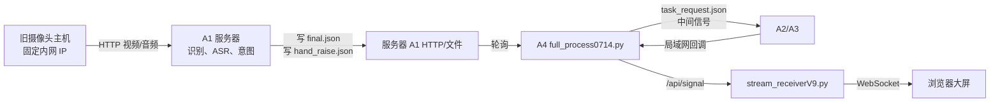
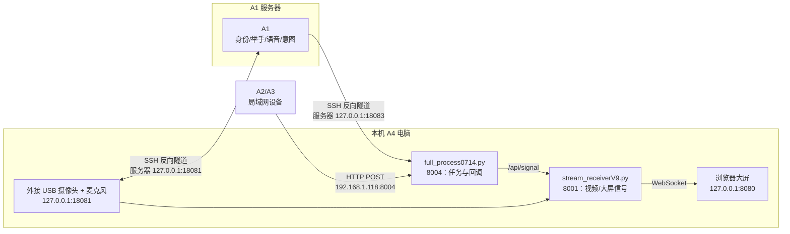

# A1A4 集成架构说明

## 1. 模块位置与职责

- **A1（服务器）**：身份识别、举手识别、语音识别、意图理解、生成找人/取物任务。
- **A4（本机）**：任务状态机、A2/A3 回调接收、三路视频汇聚和浏览器大屏。
- **本机音视频采集服务**：外接 `720P USB Camera`（摄像头编号 `1`）与其麦克风，监听 `127.0.0.1:18081`。
- **A2/A3（局域网设备）**：向本机 A4 回调任务进度和状态信号。

A1 与 A4 仍是两个职责清晰的模块；集成指消除旧的中间文件轮询，改为直连通信，并统一本机启动。

## 2. 原始架构（首次修改前）



特点：A4 需要持续轮询 A1 的 `final.json` 和 `hand_raise.json`；识别事件先落到中间文件，再进入任务流程。

## 3. 最终架构（当前版本）



## 4. A1 到 A4 的直连事件

A1 统一通过 SSH 隧道访问本机 A4：

```text
服务器 127.0.0.1:18083/a1/task
        ↓ SSH 反向隧道
本机 127.0.0.1:8004/a1/task
```

`full_process0714.py` 按事件类型处理：

| A1 事件 | A4 行为 |
| --- | --- |
| `wait_person` | 调用原有找人任务流程 |
| `fetch_object` | 调用原有取物任务流程 |
| `wake_event`：语音唤醒、举手唤醒、语音+举手 | 发送 `listen` 大屏信号，显示 A1 的 `response_text` |
| `gesture_result` + `hand_raise=true` | 发送 `listen` 大屏信号 |

旧的 A1 轮询启动代码保留为注释，不再执行：

```python
# threading.Thread(target=hand_raise_monitor, daemon=True).start()
# file_monitor_and_task_dispatcher()
```

## 5. A2/A3 通信

A2/A3 不经过 SSH，也不经过 A1 服务器。若与本机处于同一局域网，应向：

```text
POST http://192.168.1.118:8004/
Content-Type: application/json
```

例如：

```json
{"event": "fetch-start", "source": "A2"}
```

A4 将原有状态机结果转为 `/api/signal`，再由 `stream_receiverV9.py` 通过 WebSocket 推送到大屏。

## 6. 端口与启动顺序

| 位置 | 端口 | 用途 |
| --- | ---: | --- |
| 本机 | 18081 | 外接 USB 摄像头和麦克风服务 |
| 本机 | 8001 | A4 视频汇聚与大屏信号服务 |
| 本机 | 8004 | A4 任务入口和 A2/A3 回调 |
| 本机 | 8080 | 浏览器大屏 |
| 服务器 | 18080 | A1 HTTP/视频服务 |
| 服务器回环 | 18081 | SSH 映射到本机音视频服务 |
| 服务器回环 | 18083 | SSH 映射到本机 A4 `/a1/task` |

启动顺序：

1. 本机运行 `start_a1a4_local.ps1`。它会启动 A4 服务、自动启动音视频采集，并建立 SSH 隧道。
2. 服务器运行 `cd /data0/tangt/a1_system/a1_full_pipeline_improved & bash run_streaming_a1_full_20260624.sh`。
3. 浏览器访问 `http://127.0.0.1:8080/`。

